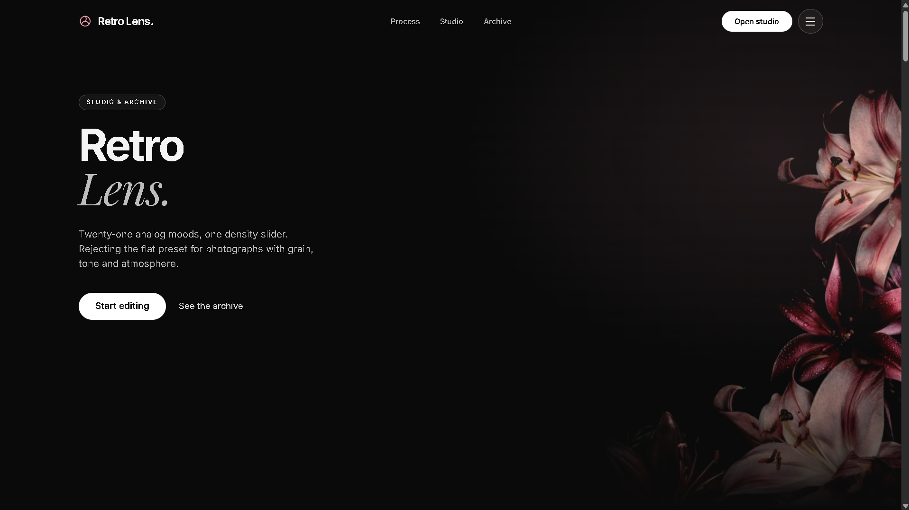
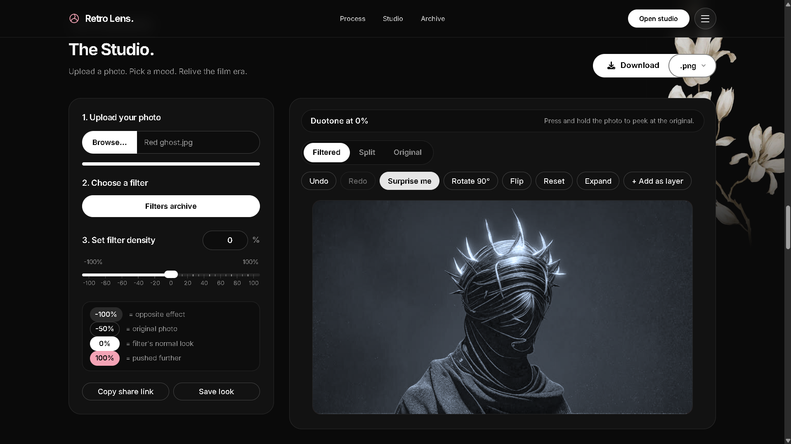
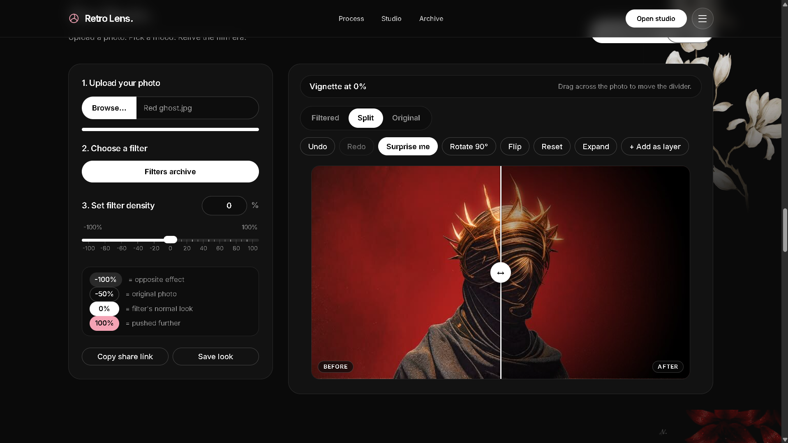
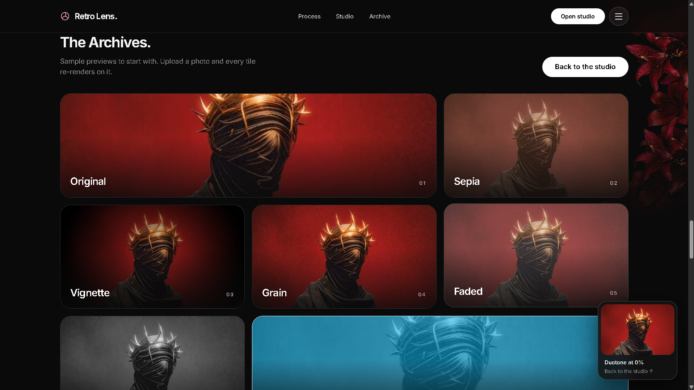
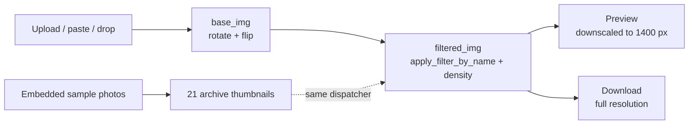

<div align="center">

```
 ____  _____ _____ ____   ___    _     _____ _   _ ____
 |  _ \| ____|_   _|  _ \ / _ \  | |   | ____| \ | / ___|
 | |_) |  _|   | | | |_) | | | | | |   |  _| |  \| \___ \
  |  _ <| |___  | | |  _ <| |_| | | |___| |___| |\  |___) |
 |_| \_\_____| |_| |_| \_\\___/  |_____|_____|_| \_|____/
```

### A dark, editorial-style photo filter studio, built entirely in R Shiny.

**21 film-inspired looks · a density dial from inverted to exaggerated · stackable layers · undo/redo · share links · full-resolution export**

<br>

[](https://parmar.shinyapps.io/retro-lens)


<br>

**[Try it live](https://parmar.shinyapps.io/retro-lens)** · **[Features](#-features)** · **[Run locally](#-run-it-locally)** · **[Filters](#-the-21-filters)** · **[Shortcuts](#-keyboard-shortcuts)** · **[How it works](#-how-it-works)**

</div>

---

## 📸 Preview

> **Add your screenshots here.** Create an `assets/` folder in the repo, drop in the images, and uncomment the lines below.

<!--
<p align="center">
  
</p>

| Studio | Split view | Filter archive |
|:--:|:--:|:--:|
|  |  |  |

<p align="center">
  
</p>
-->

---

## ✨ What is Retro Lens?

Upload a photo, pick one of 21 film-inspired looks, and dial the strength anywhere from an **inverted effect to a doubled one**. Compare against the original with a draggable split divider, then export the result at full resolution.

Everything lives in **one `app.R`**. The flower imagery and the filter-thumbnail sample photos are embedded in the file, so there is no `www/` folder or other asset to carry around. Copy one file, run it, and you are in the studio.

---

## 🎞️ Features

| | Feature | Details |
|---|---|---|
| 🎨 | **21 filters** | Film-inspired looks from Sepia and Noir to Cyanotype, Emboss and Pixelate. [Full list below](#-the-21-filters). |
| 🎚️ | **Density slider (-100% to +100%)** | 0% is the filter's normal look. Positive values push it further, up to double strength at +100%. Negative values move toward the opposite effect, and -50% lands exactly on the unfiltered photo. Type a value in the number box if you prefer. |
| 🧱 | **Stackable layers** | Combine more than one look on the same photo. |
| ↩️ | **Undo / redo** | Step backward and forward through your edits without losing work. |
| 🔗 | **Share links** | Send a link to your setup so someone else can open the same look. |
| 🪟 | **Three view modes** | **Filtered**, **Split** (draggable divider) and **Original**. Press and hold the photo to peek at the original. |
| 🛠️ | **Photo tools** | Rotate 90°, flip, **Surprise me** (random filter), reset and fullscreen. |
| 📥 | **Flexible loading** | Drag and drop, paste from the clipboard, or click to browse. |
| 🗂️ | **Filter archive** | A bento-style grid of thumbnails, each rendered with that exact filter, plus a small live preview that follows you down the page. |
| 💾 | **Full-resolution export** | Download as **PNG, JPG or WebP**. The in-browser preview is downscaled to 1400 px, but the download is not. |
| ⌨️ | **Keyboard-first** | Shortcuts for filters, density, view mode, reset and more. [See the table](#-keyboard-shortcuts). |
| 🖤 | **Editorial landing page** | Hero, numbered process steps, filter archive, statement and footer, in a dark Floria-inspired style set in Inter and Playfair Display italic. |

---

## 🚀 Quick start

1. Open the **[live demo](https://parmar.shinyapps.io/retro-lens)**.
2. Scroll to **The Studio**, or press the hero's **Edit** button, and upload a photo.
3. Choose a filter from the archive.
4. Set the density with the slider or the number box.
5. Compare with **Filtered / Split / Original**, and rotate or flip if needed.
6. Click **Download** and pick your format.

> Choosing a filter always resets density to 0%. Uploading a new photo resets the filter, density, rotation and flip.

> The live demo is hosted on a free shinyapps.io plan. If it has been idle it may take a few seconds to wake up, and it can pause when the monthly active hours run out. Running it locally always works.

---

## 💻 Run it locally

### Requirements

- **R 4.1 or newer** (the code uses the native pipe `|>`)
- R packages: `shiny`, `magick`, `base64enc`
- **ImageMagick** is bundled with the `magick` package on Windows and macOS. On Linux you may need the system library first:

  ```bash
  # Debian / Ubuntu
  sudo apt-get install libmagick++-dev

  # Fedora
  sudo dnf install ImageMagick-c++-devel
  ```

- An internet connection in the browser to load Google Fonts (Inter, Playfair Display and the others the page references). The app still works without it, using fallback fonts.

### Install and run

```r
install.packages(c("shiny", "magick", "base64enc"))
```

Then, from the folder containing `app.R`:

```r
shiny::runApp("app.R")
```

or from a terminal:

```bash
Rscript -e 'shiny::runApp("app.R", launch.browser = TRUE)'
```

### Get the code

```bash
git clone https://github.com/BERSERKER1706/Retro.git
cd Retro
```

---

## 🎨 The 21 filters

<div align="center">

| # | Filter | Mood | # | Filter | Mood |
|:-:|---|---|:-:|---|---|
| 1 | **Sepia** | Old family album | 11 | **Bright** | Airy and lifted |
| 2 | **Vignette** | Dark, focused edges | 12 | **Moody** | Dark and desaturated |
| 3 | **Grain** | Gritty film stock | 13 | **Negative** | Colours inverted |
| 4 | **Faded** | Sun-bleached memory | 14 | **Poster** | Flat, reduced colours |
| 5 | **Noir** | High-contrast black and white | 15 | **Blur** | Soft focus |
| 6 | **Duotone** | Two-colour poster look | 16 | **Cyanotype** | Blueprint-blue print |
| 7 | **Vintage** | Warm, aged print | 17 | **Sunset** | Orange-pink wash |
| 8 | **Warm** | Golden-hour glow | 18 | **Emboss** | Raised, carved relief |
| 9 | **Cool** | Cold, blue-leaning tones | 19 | **Sketch** | Pencil-drawn edges |
| 10 | **Dramatic** | Punchy contrast | 20 | **Pixelate** | Chunky retro pixels |

</div>

<p align="center"><sub>Plus <b>Original</b>, the untouched photo, which makes 21 looks in total.</sub></p>

---

## ⌨️ Keyboard shortcuts

Active once a photo is loaded and you are not typing in a field.

| Key | Action |
|:-:|---|
| `←` / `→` | Previous / next filter (also moves the Split divider when it has focus) |
| `↑` / `↓` | Density ±5 (hold `Shift` for ±1) |
| `C` (hold) | Show the original |
| `M` | Cycle view mode |
| `S` | Surprise me |
| `R` | Reset everything |
| `F` | Fullscreen |

---

## 🧠 How it works



- **`apply_*()` functions:** one per filter, built on `magick` (`image_modulate`, `image_colorize`, `image_contrast`, `image_noise`, `image_quantize` and more).
- **`apply_filter_by_name()`:** a single dispatcher used by both the main preview and the thumbnails, so they always match.
- **Density scaling:** `density_to_t()` maps the slider range to an internal strength `t`. Slider -50 lands exactly on the unfiltered photo, 0 on the filter's standard look, and +100 on double strength. The helpers `scale_mod`, `scale_amt` and `scale_contrast` scale each filter's parameters by `t`.
- **Vignette:** `magick` has no `image_vignette()`, so the effect is built from a radial mask composited with `multiply`.
- **Server state:** reactive values hold the current filter, density, rotation and flip. `base_img()` applies rotation and flip, then `filtered_img()` applies the filter. The same `filtered_img()` feeds both the preview and the download.
- **Instant comparison:** original and filtered images are sent to the browser as data URIs and layered, so switching modes and dragging the Split divider need no server round trip.
- **Start-up:** the embedded images are decoded and written to a temporary folder served under `/art/`, and the 21 archive thumbnails are rendered once from the embedded sample photos.

---

## 🗂️ Project structure

```
Retro/
├── app.R       # the whole app: helpers, filters, UI (HTML/CSS/JS), server, embedded images
└── README.md
```

`app.R` is large (roughly 1 MB, about 9,000 lines) because the images are base64-encoded inside it. The filter logic and server are near the top and bottom, and the bulk in between is UI markup, CSS and JavaScript. That trade-off keeps deployment to a single file.

---

## 🧩 Customising

**Add a filter**

1. Write an `apply_yourfilter(img, t)` function.
2. Add its name to `filter_names`.
3. Add a case in `apply_filter_by_name()`.
4. Give it a sample photo in the `sample_for` list so its thumbnail renders.

**Change the look:** colours, fonts and spacing are set in the CSS inside the `ui` definition.

---

## ☁️ Deploy your own

The app runs on [shinyapps.io](https://www.shinyapps.io) with a single command, since everything is in one file.

```r
install.packages("rsconnect")
rsconnect::setAccountInfo(name = "<account>", token = "<token>", secret = "<secret>")
rsconnect::deployApp(appFiles = "app.R", appName = "retro-lens")
```

---

## 🛠️ Troubleshooting

| Problem | Fix |
|---|---|
| `there is no package called 'magick'` | Run the install command above. On Linux, install the ImageMagick dev libraries first. |
| Photo won't load | Only **PNG and JPG** are accepted for upload. Convert HEIC or WebP photos first. |
| Slow on huge photos | Filters run on the full-size image so the download keeps full quality, so very large photos take longer per change. Resize to around 4000 px on the long side for a snappier feel. |
| Fonts look different | The page loads Google Fonts from the internet. Offline, it falls back to system fonts. |
| Live demo shows "disconnected" | The free hosting plan sleeps when idle or runs out of monthly hours. Reload, or run locally. |

---

## 🗺️ Roadmap

- [ ] Split `app.R` into `R/filters.R`, `R/ui.R`, `www/` assets and `server.R`
- [ ] Accept HEIC and WebP uploads
- [ ] Run filters on a downscaled copy for the live preview, and on the full image only for download
- [ ] Pin dependencies with `renv`
- [ ] Add screenshots and a demo GIF to this README

---

## 🤝 Contributing

Ideas, bug reports and new filters are welcome.

1. Fork the repo and create a branch: `git checkout -b feature/new-filter`
2. Make your change and test it with `shiny::runApp("app.R")`
3. Open a pull request describing what you added

---

## 👤 Author

Built by **Sir Skull** ([@BERSERKER1706](https://github.com/BERSERKER1706)), B.Tech Computer Science student at B.K. Birla Institute of Engineering and Technology, Pilani.

If Retro Lens made your photo look better, a ⭐ on the repo is much appreciated.

---

## 📄 License

Released under the **MIT License**. Add a `LICENSE` file to the repo root with the standard MIT text to make this official.

<div align="center">

<br>

**[▶ Open Retro Lens](https://parmar.shinyapps.io/retro-lens)**

<sub>Shot on R · Developed in Shiny · Printed with magick</sub>

</div>
